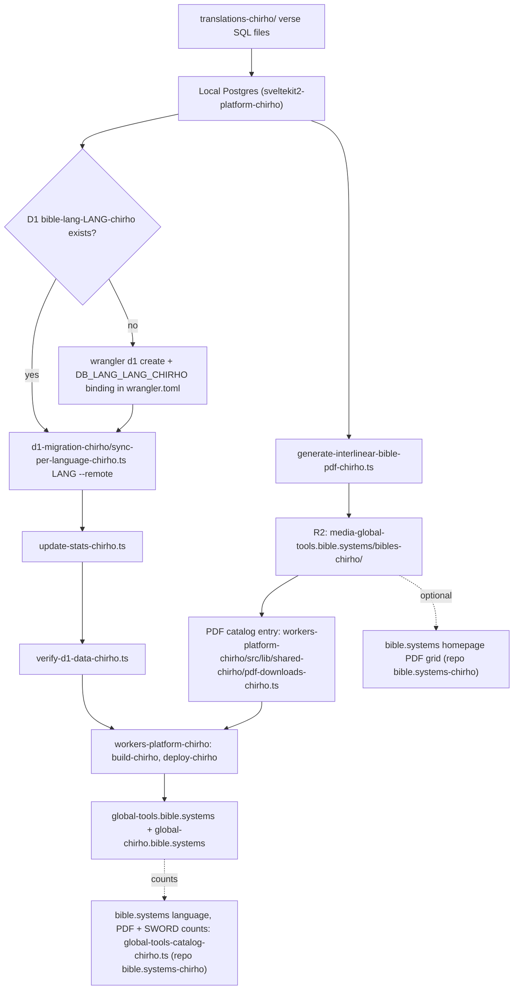

# For God so loved the world, that He gave His only begotten Son,
# that all who believe in Him should not perish but have everlasting life.
# — John 3:16

# Publish a Language to Production (Worker + D1)

Production is the Cloudflare Worker `bible-reader-chirho` (`workers-platform-chirho/`) on the
custom domains global-tools.bible.systems and global-chirho.bible.systems. The local Postgres is
the source of truth; production only reads D1 and R2. (The Hetzner VPS path was retired
2026-10-26.) Step-by-step commands: `.claude/skills/publish-language-chirho/SKILL.md`.

The PDF catalog feeds both the downloads page and the PDF buttons on `/read-chirho/<code>`. Every
PDF link points at R2 (`media-global-tools.bible.systems`); nothing on the Worker serves PDFs or
generates them, so links to `global-tools.bible.systems/bibles-chirho/*.pdf` or
`/api-chirho/pdf-chirho/*` (old VPS paths) are broken.

`wrangler deploy` replaces the Worker's custom-domain set with the `routes` list in
`workers-platform-chirho/wrangler.toml`, so both hostnames must stay listed there.
